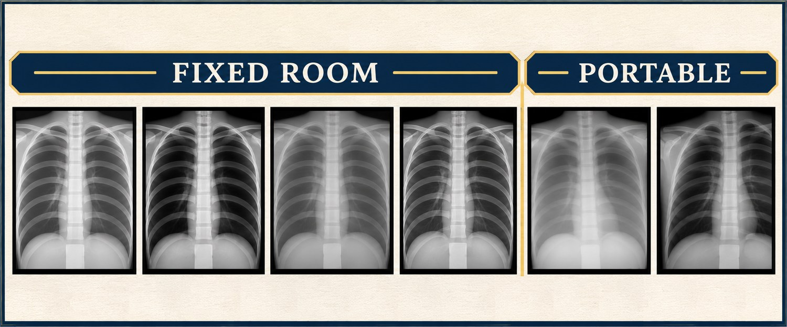
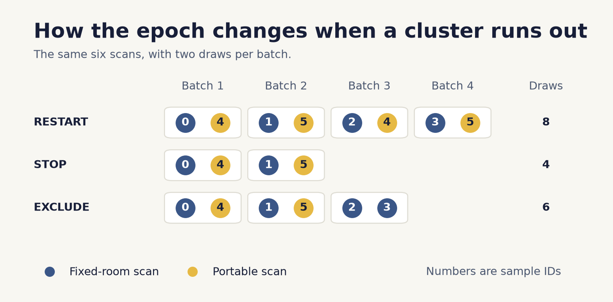

# Put different kinds of examples in each training batch



Shuffling mixes a training set over an epoch, but many batches can still be dominated by a common pattern. A speech command model trained mostly on quiet recordings may see background conversation in very few updates. If embeddings separate those acoustic conditions, drawing across clusters can expose the model to both more regularly.

`GoldClusterizedBatchSampler` groups samples by embedding similarity, then draws across the resulting pools. The cluster count determines how many pools compete for the available batch positions.

## Draw each batch from several groups

Here, four vectors come from one neighborhood and two from another. The `mode` field lets us inspect batch composition. The k-means estimator uses only the vectors. With two clusters, a batch size of two, and `RESTART`, each batch will contain one sample from each group.

```python
from uuid import uuid4

import torch
from sklearn.cluster import KMeans
from torch.utils.data import DataLoader

from goldener import GoldClusterizedBatchSampler, GoldClusterizer, GoldSKLearnClusteringTool
from goldener.organize import ExhaustedClusterStrategy

vectors = torch.tensor(
    [[0.0, 0.0], [0.1, 0.0], [0.0, 0.1], [0.1, 0.1], [5.0, 5.0], [5.1, 5.0]],
)
training_data = [
    {"idx": pos, "vectorized": vector, "mode": "A" if pos < 4 else "B"}
    for pos, vector in enumerate(vectors)
]
clusterizer = GoldClusterizer(
    table_path=f"batch_clusters_{uuid4().hex}",
    clustering_tool=GoldSKLearnClusteringTool(KMeans(random_state=0)),
)
batch_sampler = GoldClusterizedBatchSampler(
    dataset=training_data,
    batch_size=2,
    n_clusters=2,
    clusterizer=clusterizer,
    shuffle=False,
    strategy=ExhaustedClusterStrategy.RESTART,
)
loader = DataLoader(training_data, batch_sampler=batch_sampler)

seen = []
for batch in loader:
    assert sorted(batch["mode"]) == ["A", "B"]
    seen.extend(batch["idx"].tolist())
    print(batch["idx"].tolist(), batch["mode"])

assert len(seen) == 8
assert set(seen) == set(range(len(training_data)))
```

The epoch draws four batches, so each sample in group B appears twice and each sample in group A appears once. In training you would use the data and targets from each batch in the optimizer step. Pass the sampler as `batch_sampler` because it supplies complete index lists to the `DataLoader`.

## Decide what happens when a pool runs out

The three `ExhaustedClusterStrategy` policies make different trade-offs on those same two pools.

| Policy | What happens with four samples in A and two in B |
| --- | --- |
| `RESTART` (default) | Draw four mixed batches by cycling through group B a second time. Both modes appear throughout the epoch, and the smaller pool is oversampled. |
| `STOP` | Yield the second mixed batch, then stop because group B is exhausted. Two samples from group A go unused in that epoch. |
| `EXCLUDE` | Draw two mixed batches, then one batch of group A alone. Each sample is used once in this example, and the tail has less variety. Other pool sizes can leave a smaller final batch. |

The same pool sizes can represent four fixed-room scans and two portable scans.



Choose based on how much repetition you can tolerate and whether an epoch needs to reach every training sample. For a model that predicts outcomes from user event sequences, `RESTART` can keep a small cluster of long sessions in the mix, but it will repeat those same sessions. Use `EXCLUDE` if you want to use every session without recycling the rare pool and can tolerate less variety near the end of an epoch. With more clusters than batch positions, each update sees a subset of the pools. With fewer clusters, the sampler can draw several examples from a pool within a batch. The example disables shuffling to make the draws easy to inspect. In training, shuffling changes the order of samples within pools and helps vary which pools appear when a batch can only fit some of them.

## Keep the clusters aligned with the training data

Supply vectors as above, or pass a `GoldDescriptor` and an optional `GoldVectorizer` to the sampler before clustering. If you pass a descriptor alone, match the clusterizer's `vectorized_key` to the descriptor's `description_key`, which defaults to `"embeddings"`. One vector per item and a single fit over the training population give each item one batch pool. The sampler retrieves source `idx` values as dataset positions, so make sure they identify positions in the dataset fed to the loader. For a PyTorch `Subset`, supply base-dataset positions as `idx` so the sampler can map them to positions in the subset. [How to inspect an embedding partition](GOLD_CLUSTERIZER.md)

Cluster balancing changes which examples meet in an optimizer update and, with `RESTART`, how often the smaller pools contribute. Embedding-density weights let you adjust a sample's draw frequency or loss contribution based on its local rarity. Compare the policies on the evaluation slices that matter to the model. [Weighting training samples by embedding density](GOLD_DENSITY_WEIGHING.md) · [Zhao and Zhang on stratified minibatch sampling](https://arxiv.org/abs/1405.3080)
