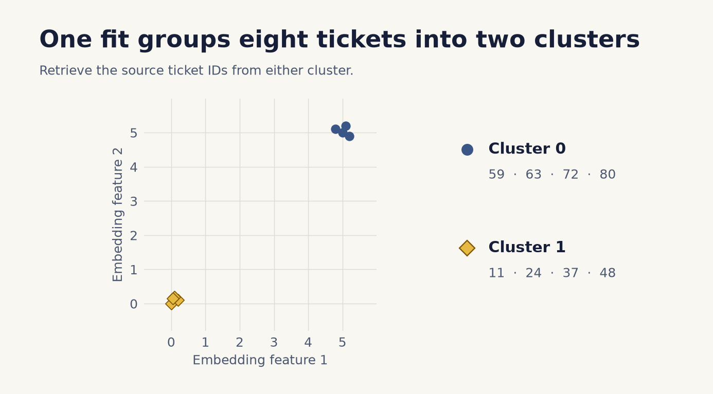

# Use embedding clusters to investigate model errors

## TL;DR

Use `GoldClusterizer` to group similar vectors and retrieve the source samples for review. For monitoring over time, fit a clustering tool once and use `predict` to assign new vectors to the same groups.

## Table of contents

- [Group misrouted support tickets](#group-misrouted-support-tickets)
- [Track the same groups in later sensor windows](#track-the-same-groups-in-later-sensor-windows)
- [Read assignments by vector or sample](#read-assignments-by-vector-or-sample)
- [Choose which vectors to fit together](#choose-which-vectors-to-fit-together)

An error rate tells you how often a model fails. To decide what to fix, you need to see which errors have something in common. If a classifier sends many support tickets to the wrong queue, grouping their text embeddings can help you find repeated patterns. Read tickets in one cluster to see whether a new form template makes different requests look alike or whether one routing rule needs a clearer definition.

`GoldClusterizer` stores those assignments so you can retrieve members by sample ID. You can use the same workflow before training to find borderline examples and write annotation guidelines.

## Group misrouted support tickets

Eight synthetic vectors stand in for tickets routed to the wrong queue. There are two visibly separate neighborhoods in the toy space. The clusterizer runs one k-means fit over the queue and links each assignment to its original sample.

```python
from uuid import uuid4

import torch
from sklearn.cluster import KMeans

from goldener import GoldClusterizer, GoldSKLearnClusteringTool

vectors = torch.tensor(
    [
        [0.0, 0.0], [0.2, 0.1], [0.1, 0.2], [0.05, 0.15],
        [5.0, 5.0], [5.2, 4.9], [4.8, 5.1], [5.1, 5.2],
    ],
)
sample_ids = [11, 24, 37, 48, 59, 63, 72, 80]
rows = [
    {"idx": sample_id, "idx_vector": pos, "vectorized": vector}
    for pos, (sample_id, vector) in enumerate(zip(sample_ids, vectors))
]

clusterizer = GoldClusterizer(
    table_path=f"review_clusters_{uuid4().hex}",
    clustering_tool=GoldSKLearnClusteringTool(KMeans(random_state=0)),
)
table = clusterizer.cluster_in_table(rows, n_clusters=2)
groups = {
    cluster_id: clusterizer.get_cluster_indices(
        table, cluster_key="cluster", cluster_idx=cluster_id, idx_key="idx",
    )
    for cluster_id in range(2)
}

assert {frozenset(ids) for ids in groups.values()} == {
    frozenset(sample_ids[:4]), frozenset(sample_ids[4:]),
}
for cluster_id, ids in groups.items():
    print(cluster_id, sorted(ids))
```



The two neighborhoods each yield four IDs. In a real queue, use the IDs to open the original inputs. Review several members and some borderline cases before using a cluster to write an annotation guideline or change a routing rule. The fit produces cluster numbers. The review establishes what the groups mean.

The caller chooses `n_clusters`. A small count gives broader groups to review. A large count can expose narrower patterns and create more groups to inspect. The partition depends on the representation and estimator. If you start from raw data, use `GoldDescriptor` and a vectorization tool, then align the clusterizer's `vectorized_key` with the vector output column. [Lloyd's k-means method](https://doi.org/10.1109/TIT.1982.1056489)

## Track the same groups in later sensor windows

For a sensor-based fault detector, compare the share of incoming windows assigned to a known pattern. These two-dimensional vectors stand in for vibration and temperature features. Fit on a reference period, identify a group from a known high-vibration window, and use `predict` to count its assignments in a later period. Use the same feature extraction and preprocessing in both periods.

```python
import torch
from sklearn.cluster import KMeans

from goldener import GoldSKLearnClusteringTool

reference = torch.tensor([[0.2, 0.1], [0.3, 0.2], [4.0, 0.2], [4.2, 0.3]])
later = torch.tensor([[0.3, 0.1], [3.9, 0.1], [4.0, 0.2], [4.3, 0.3]])
tool = GoldSKLearnClusteringTool(KMeans(random_state=0))

reference_groups = tool.fit(reference, n_clusters=2)
high_vibration_group = reference_groups[-1]
later_groups = tool.predict(later)
reference_count = int((reference_groups == high_vibration_group).sum())
later_count = int((later_groups == high_vibration_group).sum())

assert (reference_count, later_count) == (2, 3)
print(reference_count / len(reference), later_count / len(later))  # 0.5 0.75
```

In this toy comparison, the group's share rises from half to three quarters. Open the corresponding traces to check what changed. Every incoming vector gets an existing cluster ID, so fit a new partition separately if you want to look for patterns the reference groups miss. A fresh fit has its own ID numbering.

## Read assignments by vector or sample

`GoldClusterizer` stores one assignment per vector in Pixeltable. By default, `get_cluster_indices` returns vector IDs (`idx_vector`). Pass `idx_key="idx"` for source sample IDs. A sensor trace represented by several windows can appear in several clusters.

Set `force_same_cluster=True` to write one cluster ID to every row with the same `idx`. The tool still fits the individual vectors. If vectors from the same sample receive different IDs, the last write determines the stored ID. To fit clusters on one representation per sample, combine the vectors before clustering.

## Choose which vectors to fit together

Use one fit over the whole population when you need one partition. Separate fits reuse numeric cluster IDs, so cluster 0 can describe different groups in the same table.

| Option | What gets fitted |
| --- | --- |
| `label_key` | Each label separately. Pass both `label_key` and `label_value` when retrieving a cluster from a specific label. |
| `chunk` | Each randomly assigned chunk separately. This bounds the size of each fit. Pixeltable stores the cluster ID for each vector, while chunk membership is temporary. |
| Resume with an existing table | Only pending vectors. Saved assignments are reused. |

K-means needs at least `n_clusters` vectors in every fit. Check the smallest label or chunk, especially after a partial run. If you configure a reducer that learns a projection, it fits on each population before clustering. [Reducing the dimensionality of embeddings](GOLD_REDUCTION.md)

Use a fresh result table to refit the whole population. To assign new vectors to existing groups, call `predict` with the original fitted tool.

To draw across those groups during training, configure the batch sampler with a clusterizer that fits the training population as a whole. [Building batches from embedding clusters](GOLD_BATCHER.md)
