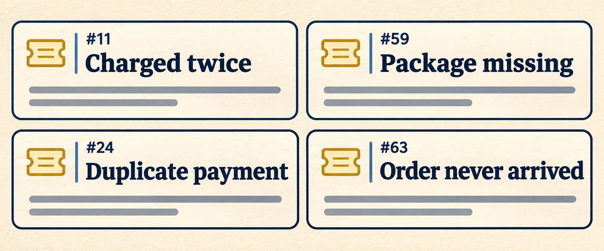

# Use embedding clusters to investigate model errors



An error rate tells you how often a model fails. To decide what to fix, you need to see which errors have something in common. If a classifier sends many support tickets to the wrong queue, grouping their text embeddings can help you find repeated patterns. Read tickets in one cluster to see whether a new form template makes different requests look alike or whether one routing rule needs a clearer definition.

`GoldClusterizer` stores those assignments so you can retrieve members by sample ID. You can use the same workflow before training to find borderline examples and write annotation guidelines.

## Turn a review queue into groups

This example uses eight synthetic vectors from a single review queue. There are two visibly separate neighborhoods in the toy space. The clusterizer runs one k-means fit over the queue and links each assignment to its original sample.

```python
from uuid import uuid4

import torch
from sklearn.cluster import KMeans

from goldener import GoldClusterizer, GoldSKLearnClusteringTool

vectors = torch.tensor(
    [
        [0.0, 0.0], [0.2, 0.1], [0.1, 0.2], [0.05, 0.15],
        [5.0, 5.0], [5.2, 4.9], [4.8, 5.1], [5.1, 5.2],
    ],
)
sample_ids = [11, 24, 37, 48, 59, 63, 72, 80]
rows = [
    {"idx": sample_id, "idx_vector": pos, "vectorized": vector}
    for pos, (sample_id, vector) in enumerate(zip(sample_ids, vectors))
]

clusterizer = GoldClusterizer(
    table_path=f"review_clusters_{uuid4().hex}",
    clustering_tool=GoldSKLearnClusteringTool(KMeans(random_state=0)),
)
table = clusterizer.cluster_in_table(rows, n_clusters=2)
groups = {
    cluster_id: clusterizer.get_cluster_indices(
        table, cluster_key="cluster", cluster_idx=cluster_id, idx_key="idx",
    )
    for cluster_id in range(2)
}

assert {frozenset(ids) for ids in groups.values()} == {
    frozenset(sample_ids[:4]), frozenset(sample_ids[4:]),
}
for cluster_id, ids in groups.items():
    print(cluster_id, sorted(ids))
```


The two neighborhoods each yield four IDs. In a real queue, use the IDs to open the original inputs. Review several members and some borderline cases before using a cluster to write an annotation guideline or change a routing rule. The fit produces cluster numbers. The review establishes what the groups mean.

## Define the population and what “similar” means

`GoldSKLearnClusteringTool` wraps an estimator such as `KMeans` and returns a cluster assignment per input vector. The call to `cluster_in_table` supplies `n_clusters`. A small count gives broader groups to review. A large count can expose narrower patterns and creates more groups to inspect. The partition reflects the representation and estimator you chose. [Lloyd's k-means method](https://doi.org/10.1109/TIT.1982.1056489)

Start from vectors in a dataset or a Pixeltable table. If you start from raw data, use `GoldDescriptor` and a vectorization tool to make the vectors, then align `vectorized_key` with the output column. Each stored assignment has an `idx_vector`, which identifies a vector, and an `idx`, which identifies the original sample. Retrieval defaults to `idx_vector`. Passing `idx_key="idx"` retrieves distinct sample IDs, as in the example. If you cluster multiple windows from a sensor trace, that trace can appear in several groups.

Use one fit for a single partition. With `label_key`, Goldener fits each label population separately, which is useful when you want to look for variations within a known class. Setting `chunk` limits memory use by fitting each chunk separately. K-means requires at least `n_clusters` vectors in every fit. Check the smallest label group or, when chunking, the smallest generated chunk within each population. Both approaches reuse numeric cluster IDs across fits. Query within a label to interpret a label-specific fit. Use an unchunked fit when you need the stored cluster IDs to identify groups in one population, since cluster IDs are reused across chunks. Chunk membership is stored in the `<table_path>_chunks` view, which adds a nullable integer `chunk` column to the intermediate table. The name `chunk` is reserved, so configurable column keys cannot use it. A `reducer` also changes the space in which the groups are found. [Reducing the dimensionality of embeddings](GOLD_REDUCTION.md)

## Track the same groups over time

Fit `GoldSKLearnClusteringTool` once on reference vectors and call its `predict` method on later vectors. Use the same embedding model and preprocessing, including the fitted reducer if you used one. Every incoming vector is assigned to an existing group. For a sensor-based fault detector, track whether more time windows are assigned to a group of high-vibration traces, then review the underlying signals and measure the error rate among labeled examples. If you want to discover new groups in recent alerts, fit a new partition and review its groups separately.

Use the Pixeltable output to reopen a completed review. A table can reuse recorded assignments, and a resumed computation fits pending vectors within their saved chunks. If any pending vector in the current label/restriction population lacks a chunk value, Goldener redraws and saves that entire pending population’s chunk assignment before fitting. Numeric cluster IDs are local to each fit. Use a new table for a fresh partition, or call `predict` with the original fitted tool to assign new vectors to its existing clusters. If the next task is to control how those groups appear during training, give Goldener's batch sampler the training data and a clusterizer configured for one fit. [Building batches from embedding clusters](GOLD_BATCHER.md)
