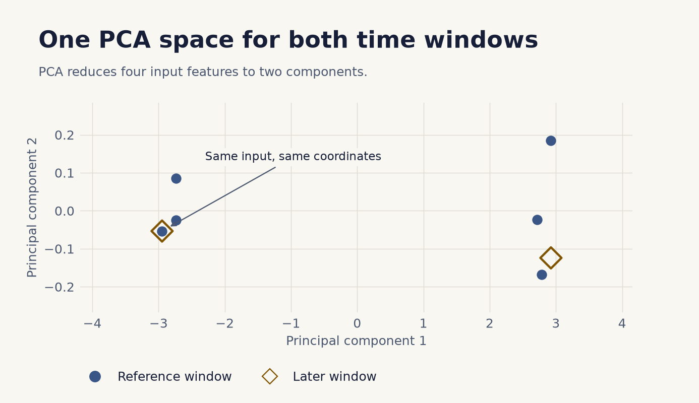

# Reduce embedding width and keep a common reference space

## TL;DR

Reduce embedding width to make similarity searches cheaper. Fit a reusable projection on reference data for comparisons over time, or use t-SNE for a one-time view of a collection.

## Table of contents

- [Fit on reference sensor data and project a later window](#fit-on-reference-sensor-data-and-project-a-later-window)
- [Map an image collection for a one-time review](#map-an-image-collection-for-a-one-time-review)
- [Fit, transform, and reuse a projection](#fit-transform-and-reuse-a-projection)
- [Choose a projection that fits the job](#choose-a-projection-that-fits-the-job)
- [Check what the smaller vectors preserve](#check-what-the-smaller-vectors-preserve)

Wide embeddings can make repeated similarity searches expensive. Reducing the feature width can save memory and speed up later searches. For example, a job that monitors sensor behavior can compare this week's signal windows with a reference archive in a smaller feature space. Fit the projection once so changes in the coordinates reflect changes in the inputs under that mapping.

`GoldSKLearnReductionTool` wraps PCA and other estimators for PyTorch tensors. Fit PCA once on representative reference vectors, then apply that fitted projection to later windows. For training and validation, learn the mapping on training vectors and reuse it on validation vectors.

## Fit on reference sensor data and project a later window

The toy tensors stand in for precomputed signal embeddings from two time windows. PCA compresses four features to two and preserves each window's row count. One later row duplicates the first reference row to show that both calls use the same fitted coordinates.

```python
import torch
from sklearn.decomposition import PCA

from goldener import GoldSKLearnReductionTool

reference = torch.tensor(
    [
        [0.0, 0.0, 0.1, 0.0],
        [0.1, 0.2, 0.0, 0.1],
        [0.0, 0.3, 0.2, 0.1],
        [4.0, 4.0, 0.0, 0.3],
        [4.2, 3.9, 0.1, 0.2],
        [4.1, 4.2, 0.0, 0.0],
    ],
)
later = torch.tensor([[0.0, 0.0, 0.1, 0.0], [4.3, 4.0, 0.2, 0.1]])
pca = PCA(n_components=2)
reducer = GoldSKLearnReductionTool(pca)

reference_reduced = reducer.fit_transform(reference)
later_reduced = reducer.transform(later)

assert torch.allclose(reference_reduced[0], later_reduced[0], atol=1e-6)
print(reference_reduced.shape, later_reduced.shape)  # (6, 2), (2, 2)
```



## Map an image collection for a one-time review

To inspect a fixed collection of images, you can use t-SNE to produce two coordinates per image for a scatter plot. Here, each row is a synthetic image embedding and each coordinate pair keeps the input image's ID. `perplexity` must be smaller than the number of rows in the fit.

```python
import torch
from sklearn.manifold import TSNE

from goldener import GoldSKLearnReductionTool

image_ids = ["a01", "a02", "a03", "b01", "b02", "b03"]
image_vectors = torch.tensor(
    [
        [0.0, 0.1, 0.0, 0.0], [0.1, 0.0, 0.2, 0.1], [0.2, 0.1, 0.0, 0.0],
        [4.0, 4.1, 0.0, 0.0], [4.2, 4.0, 0.1, 0.0], [4.1, 4.2, 0.0, 0.1],
    ],
)
reducer = GoldSKLearnReductionTool(
    TSNE(n_components=2, perplexity=2, random_state=0),
)
coordinates = reducer.fit_transform(image_vectors)
points = dict(zip(image_ids, coordinates.tolist()))

assert coordinates.shape == (len(image_ids), 2)
assert torch.isfinite(coordinates).all()
print(points)
```

Use the IDs to open neighboring images during review. Calling `transform` with more images would warn and refit t-SNE, producing a new map. For coordinates you want to compare across collections or time periods, use a method with a reusable transform. [t-SNE paper](https://www.jmlr.org/papers/v9/vandermaaten08a.html)

## Fit, transform, and reuse a projection

Pass a finite floating tensor of shape `(num_vectors, feature_dim)`. `GoldSKLearnReductionTool` preserves row order. It runs the estimator on a detached CPU NumPy array and returns the projected tensor on the input's device and with its dtype. Use a NumPy-compatible dtype that your estimator supports. For example, convert `torch.bfloat16` to `torch.float32` before calling the tool.

Call `fit` to learn the mapping or `fit_transform` to learn it and return the projected rows. Use `transform` to apply a fitted mapping when the estimator supports it. Save the fitted estimator with your preprocessing configuration to reuse its coordinates in later jobs. When the wrapper manages a NumPy `RandomState`, snapshot it with `random_state` and restore it with `update_random_state` to replay random choices.

`GoldTorchModuleReductionTool` passes the input directly to a PyTorch module, such as a trained projection head. Match the module's device and dtype to the input, and use a module that preserves the number and order of rows.

## Choose a projection that fits the job

| Method | What the projection does | What to expect for later rows |
| --- | --- | --- |
| PCA | Keeps directions of high variance in the reference data. | Applies the same fitted linear mapping. [PCA review](https://doi.org/10.1098/rsta.2015.0202) |
| Gaussian random projection | Draws a linear mapping that can approximately preserve pairwise distances with enough output dimensions. | Applies the same sampled matrix. [Random projection and the Johnson–Lindenstrauss lemma](https://doi.org/10.1002/rsa.10073) |
| UMAP | Learns a nonlinear embedding that emphasizes local neighborhoods. | Transforms points into the fitted embedding. [UMAP paper](https://arxiv.org/abs/1802.03426) |
| t-SNE | Builds a visualization of the rows in one fit. | Goldener warns and refits if you call `transform`, creating a new map. Use `fit_transform` for a one-off plot. |

## Check what the smaller vectors preserve

A projection can discard cues that matter for your downstream task. If you reduce image embeddings before searching for near-duplicates, verify that crops or resizes of the same image still find one another and that visually similar images of different subjects stay distinguishable. PCA can drop a direction that carries little total variance yet separates the cases you care about. Choose an output width by measuring resource savings and checking the effect on those cases.

Goldener's clusterizer, selector, and density weigher can apply a reducer inside their workflow. A fittable reducer is fitted on the data being processed, which can mean a separate fit per label or chunk. To compare later samples in a shared space, compute the projection once and pass the consistently projected vectors into those stages. [Clustering embeddings](GOLD_CLUSTERIZER.md) · [Weighting samples by embedding density](GOLD_DENSITY_WEIGHING.md)
