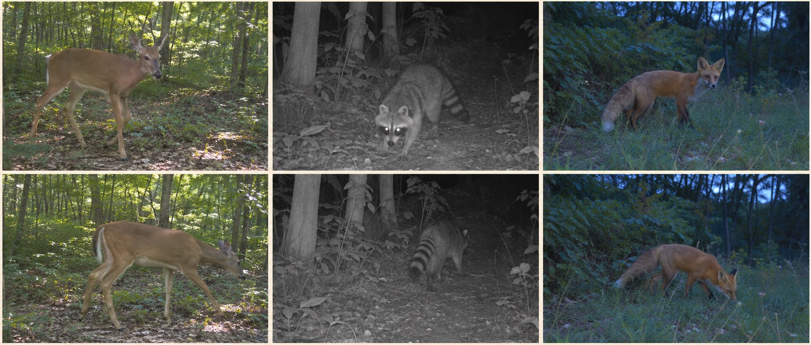
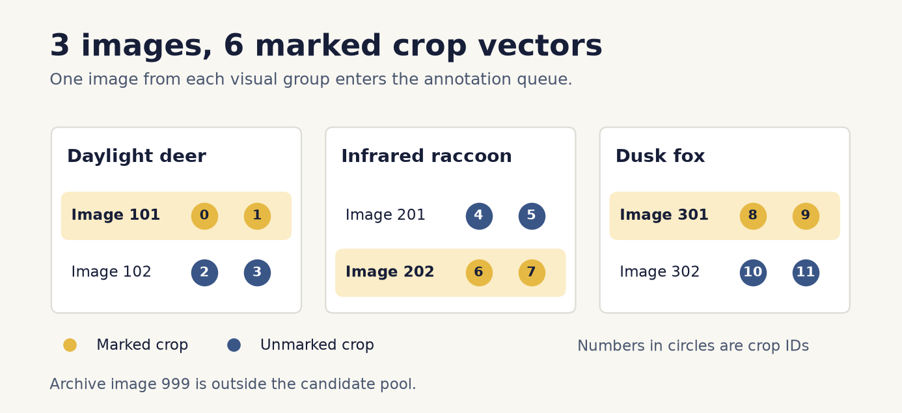

# Choose which camera-trap images to annotate



## TL;DR

Use `GoldSelector` to choose camera-trap images that cover different embedding neighborhoods. Set the annotation budget in images. Each image counts once, even when it has several crop embeddings.

## Table of contents

- [Build an image annotation queue](#build-an-image-annotation-queue)
- [From vector picks to sample IDs](#from-vector-picks-to-sample-ids)
- [Set the sample budget](#set-the-sample-budget)
- [Choose what the embeddings should capture](#choose-what-the-embeddings-should-capture)

A camera trap can capture the same deer several times in a few seconds. If those bursts dominate a collection, a random sample can spend much of an annotation budget on near-duplicates. A coverage-oriented selection can bring in visually different images, such as infrared raccoons and foxes at dusk, when their embeddings form distinct neighborhoods.

## Build an image annotation queue

The contact sheet illustrates the six images from the current collection. Each image has two synthetic crop embeddings. The crops share the source image's `idx`, while each crop has its own `idx_vector`. Image 999 comes from an earlier deployment and stays outside this annotation round.

Use a budget of three images. `GoldSelector` stores the assignment under `"annotate"` in a local Pixeltable table. Retrieve image IDs for the queue and vector IDs to inspect the crop records.

```python
from uuid import uuid4

import torch
from torch.utils.data import Subset

from goldener import GoldGreedyKCenterSelectionTool, GoldSelector

image_ids = [101, 102, 201, 202, 301, 302, 999]
crop_vectors = torch.tensor(
    [
        [[0.00, 0.00], [0.04, 0.02]],
        [[0.10, 0.00], [0.14, 0.02]],
        [[4.00, 0.00], [4.04, 0.02]],
        [[4.10, 0.00], [4.14, 0.02]],
        [[0.00, 5.00], [0.04, 5.02]],
        [[0.10, 5.00], [0.14, 5.02]],
        [[8.00, 8.00], [8.10, 8.02]],
    ],
)
rows = []
for image_id, crops in zip(image_ids, crop_vectors, strict=True):
    for vector in crops:
        rows.append({"idx": image_id, "idx_vector": len(rows), "vectorized": vector})
pool = Subset(rows, range(len(rows)))

selector = GoldSelector(
    table_path=f"camera_trap_annotation_{uuid4().hex}",
    selection_tool=GoldGreedyKCenterSelectionTool(device="cpu"),
)
table = selector.select_in_table(
    pool,
    select_size=3,
    value="annotate",
    restrict_to=set(image_ids[:-1]),
    restriction_idx_key="idx",
)
annotation_ids = selector.get_selection_indices(table, value="annotate")
selected_crop_ids = selector.get_selection_indices(
    table, value="annotate", idx_key="idx_vector",
)

# Check coverage using the three pairs shown in the contact sheet.
image_groups = ({101, 102}, {201, 202}, {301, 302})
assert len(annotation_ids) == 3
assert all(len(annotation_ids & group) == 1 for group in image_groups)
assert selected_crop_ids == {
    row["idx_vector"] for row in rows if row["idx"] in annotation_ids
}
print(sorted(annotation_ids))
```



The queue covers all three visual groups in this run. The selector sees the crop vectors and image IDs. The animal names and lighting conditions identify the groups for inspection. Open the original images by ID to annotate the species in each frame.

## From vector picks to sample IDs

Greedy K-center picks crop vectors to cover the embedding space. Once it has a center, each new pick maximizes the distance to the nearest center. Later rounds can use crops from already-selected images as anchors. Identical candidate vectors can cause the tool to return the same position more than once.

`GoldSelector` maps the picked vector positions back to image IDs and marks both crop rows for each selected image. It can take another pass when several picks come from the same image. In this example, three selected images correspond to six marked crops.

## Set the sample budget

Pass an integer `select_size` for an image count or a float for a fraction of the distinct images in scope, rounded up. To restrict the queue to a collection, pass its image IDs in `restrict_to` with `restriction_idx_key="idx"`. The default restriction key is `idx_vector`, which takes crop IDs.

If you later choose images from a tagged collection, set `label_key` to allocate part of the budget per label. The selector raises a `ValueError` when its first pass cannot allocate at least one image per label. Images tagged with several species can push the selection above its target, so check the returned count when the budget is strict.

On a repeated request, images already assigned to the same `value` count toward the budget. Images assigned to another queue value are unavailable. Use a fresh result table when the embeddings or selection recipe change.

## Choose what the embeddings should capture

Use a pretrained vision model with `GoldTorchEmbeddingTool` and `GoldDescriptor` to extract features. Vectorize the features inside the descriptor with `GoldTensorVectorizationTool` or in a separate `GoldVectorizer` stage. Keep the source image ID on both crop rows and point the selector's `vectorized_key` at their vector column.

Review what drives differences between images before sending them to annotation. An embedding might emphasize lighting or foliage more than the animal. Greedy K-center can also prioritize an isolated corrupted frame. For a large camera-trap collection, chunking limits the per-chunk computation and makes coverage decisions within smaller pools. Reducing vector width can save work, so check that it preserves the distinctions you want to annotate. [Reducing the dimensionality of embeddings](GOLD_REDUCTION.md)

When the goal changes from seeking visual coverage to keeping the selected images closer to the collection's distribution, `GoldGreedyKernelPointsSelectionTool` aims to approximate that distribution in its chosen kernel space. [Coreset selection survey](https://arxiv.org/abs/2505.17799)

Sponsored by [Pixeltable](https://www.pixeltable.com/).
