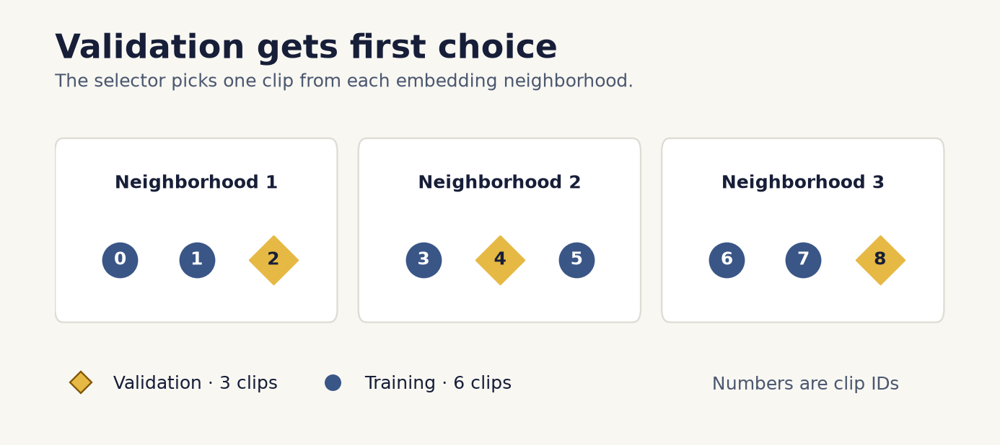

# Split labeled data with semantic coverage in mind


A train and validation split can match label counts while missing variation within a label. For a video activity classifier, a small validation set could contain plenty of clips of the common activities, filmed mostly from a single viewpoint. Once you have set aside independent recordings for validation, embedding-based selection can help you choose clips that cover several viewpoints from those recordings.

`GoldSplitter` uses a selection algorithm to fill named sets in the order you supply. Give the first set a coverage objective, then decide whether the remaining data is suitable for the role you assign it.

## Reserve a validation set for checking known variation

Here, nine labeled samples already have an embedding vector each. The vectors form three neighborhoods within the same class. We choose three validation samples first so that a small diagnostic set can cover all three modes. The training set gets the six remaining samples.

```python
from uuid import uuid4

import torch
from torch.utils.data import Subset

from goldener import GoldGreedyKCenterSelectionTool, GoldSelector, GoldSet, GoldSplitter

vectors = torch.tensor(
    [
        [0.0, 0.0], [0.1, 0.0], [0.0, 0.1],
        [4.0, 0.0], [4.1, 0.0], [4.0, 0.1],
        [0.0, 5.0], [0.1, 5.0], [0.0, 5.1],
    ],
)
rows = [
    {"idx": pos, "idx_vector": pos, "vectorized": vector, "label": "same_label"}
    for pos, vector in enumerate(vectors)
]
dataset = Subset(rows, range(len(rows)))

selector = GoldSelector(
    table_path=f"split_demo_{uuid4().hex}",
    selection_tool=GoldGreedyKCenterSelectionTool(device="cpu"),
    label_key="label",
)
splitter = GoldSplitter(
    sets=[GoldSet("validation", 3), GoldSet("train", 6)],
    selector=selector,
)
table = splitter.split_in_table(dataset)
splits = splitter.get_split_indices(table)

validation = Subset(dataset, sorted(splits["validation"]))
training = Subset(dataset, sorted(splits["train"]))
assert splits["validation"].isdisjoint(splits["train"])
assert {pos // 3 for pos in splits["validation"]} == {0, 1, 2}
print(len(validation), len(training))  # 3 6
```



`get_split_indices` groups the stored assignments by set name and returns sets of sample IDs. This example makes those IDs the dataset positions so they work directly in `Subset`. For catalog IDs, look up their dataset positions first.

## Decide which set gets first choice

Each `GoldSet` supplies a unique name and a target size. Use either counts that sum to the number of distinct samples or fractions that sum to one. The splitter fills each set before the last through selection on the available samples. With fractions, those targets round down with a minimum of one sample, so leave enough examples for the final set. The last set receives all unassigned samples. A fraction passed directly to `GoldSelector` rounds up.

In the example, validation gets first choice across the three modes. Reverse the roles and a training set chosen first gets the coverage objective, with validation inheriting the remainder. With more than two sets, every later selection has fewer candidates. Inspect the label and mode coverage of each result, especially when a mode has only a handful of samples. A selector with `label_key` allocates selections by label as well, so each actively selected set needs a workable budget for its label populations.

## Connect the pipeline to your data

`GoldSplitter` can run a `GoldDescriptor` to extract embeddings, a `GoldVectorizer` if the embeddings still need to become vectors, and an optional `GoldClusterizer` to allocate selection across groups when `n_clusters > 1`. Those stages, when provided, run before the selector. Match each stage's input column to the previous stage's output. With precomputed vectors, supply the selector directly as shown above. The selector persists assignments in Pixeltable. Reuse the table to resume the same split, and start a new table if you change the set order or selection criteria. When a sample has multiple vector rows, those rows share its `idx`, have distinct `idx_vector` values, and belong to the same set. [Selecting an embedding-based subset](GOLD_SELECTION.md) · [Clustering embeddings](GOLD_CLUSTERIZER.md)

## Design the split around the evaluation question

A coverage-oriented validation set can expose failures on familiar modes. Keep all clips from a held-out video recording out of training, including clips you skip when choosing a diagnostic review subset. With tabular transaction data, use a later holdout if the question is how a model handles changes in customer behavior after deployment. Keep the date boundary intact when selecting training examples. The splitter tracks samples by ID, so grouping related records and enforcing a time boundary happen outside this workflow.

Use a holdout that reflects the population you want to score when the result needs to estimate deployment performance. The diagnostic validation set above is intentionally chosen for variation. Joseph and Vakayil study another approach to geometry-based splitting, using support points to reflect the full dataset's distribution. [SPlit: An optimal method for data splitting](https://doi.org/10.1080/00401706.2021.1921037)

Original post by [Yann Chéné](https://huggingface.co/Yann-CV). Sponsored by [Pixeltable](https://www.pixeltable.com/).
